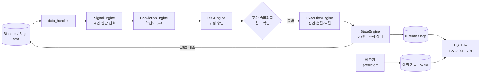

# Horizon Bot Beta

바이낸스 현물과 USDT-M 무기한 선물을 매매하는 자동매매 봇과, 코인 60개의 4시간·8시간 뒤 가격 방향을 예측해 기록·채점하는 예측기입니다. 맥북에서 혼자 운영하는 것을 기준으로 설계했습니다.

> **기본은 가상 매매입니다.** 실제 주문을 내지 않고, API 키를 읽지 않으며, 거래소 공개 시세만 씁니다. 실거래는 사용자가 직접 확인 문구를 입력해야만 켜집니다. 선물 거래는 원금 이상의 손실이 날 수 있습니다.

## 한눈에 보기

| 항목 | 내용 |
|---|---|
| 기간 | 2026.05 – 2026.11 (개인 프로젝트) |
| 언어 | Python (약 19,900줄) |
| 테스트 | pytest 테스트 313개, 미래 정보 유출 검사 포함 |
| 대상 | 매매 봇 10개 심볼(현물·선물 선택), 예측기 60개 코인 |
| 연구 | 모델 v3 – v18, 버전마다 판정 기준을 먼저 등록한 뒤 검증 |

## 무엇을 하나

| 프로그램 | 하는 일 | 실행 |
|---|---|---|
| 매매 봇 | 시장 국면 판단 → 신호 → 확신도 → 위험 승인 → 주문(가상 또는 실거래) → 손절·익절·부분 청산 관리 | `./run_mac.sh` |
| 예측기 | 4시간봉 마감마다 코인 60개의 방향과 시장 대비 예측, 큰 코인 30개의 "얼마나 오를까"를 기록하고, 기간이 끝나면 채점. 퀀트 구조의 그림자 장부(v15)도 함께 기록 | `./run_predictor.sh` |
| 대시보드 | 잔고·포지션·미실현 손익·청산가·예측 적중률·코인 조회를 보여 주는 로컬 전용 화면 | `./run_dashboard.sh` |
| 재실행기 | 봇의 실제 파이프라인·위험·주문 엔진을 과거 분봉 위에서 그대로 돌려 결과를 재현 | `replay/` |

## 주요 기능

### 국면별 매매 전략 (`signal_engine.py`, `conviction_engine.py`)
- 15분봉의 ADX와 ATR 백분위로 시장을 **추세(TREND) · 횡보(RANGE) · 저변동(LOW_VOL)** 세 국면으로 나눕니다.
- 국면마다 진입 규칙이 다릅니다: 추세는 20봉 돌파, 횡보는 RSI 40/60, 저변동은 변동성 돌파.
- EMA50/200 추세 방향, 거래량 증가, 모멘텀, 변동성 확대로 0 – 4점 확신도를 매깁니다.

### 위험 관리 (`risk_engine.py`)
- 거래당 자산의 0.75%, 전체 포지션 합계 5%까지만 위험을 겁니다.
- 낙폭 5%에서 위험을 절반으로, 10%에서 거래를 멈춥니다.
- 레버리지와 명목 금액은 자산의 3배 이하로 제한합니다.
- 연속 손실 뒤 쿨다운, 심볼별 시간당 거래 횟수 제한을 둡니다.
- 진입 전 호가로 예상 슬리피지를 계산해 한도(기본 0.5%)를 넘으면 주문하지 않습니다.

### 주문 상태의 일관성과 장애 복구 (`state_engine.py`, `utils/`)
- 포지션 수명주기를 **이벤트 소싱**으로 기록하고, 버전 충돌을 감지합니다(낙관적 동시성).
- 15초마다 거래소와 상태를 대조(reconcile)하면서도 수명주기 정보를 잃지 않습니다.
- 익절 처리의 멱등성, 부분 청산 뒤 손절 주문 교체, 재시작 뒤 손절 주문 복구, 손절 주문 감시(watchdog)를 갖췄습니다.
- 원자적 JSON 쓰기, 프로세스 잠금, 재시도 스케줄러, 저하 모드(degraded mode)를 둡니다.

### 방향 예측 모델 (`research/direction.py`, `predictor/`)
- numpy로 직접 구현한 **릿지 회귀**를 매달 다시 학습합니다(워크포워드).
- 특징: 수익률(1/6/42/168봉), 변동성, BTC 수익률, 자금조달비, 거래량, 범위 내 위치, 시각. 버전별로 체결 쏠림·베이시스(v5), S&P500·VIX·달러 지수(v6), 미결제약정·롱숏 비율(v7), 코인 간 순위(v11)를 시험했습니다.
- 예측은 방향, 시장 대비 방향, 큰 코인 30개의 "얼마나 오를까"(8시간·24시간·3일·7일) 세 종류입니다.

### 퀀트 구조 그림자 장부 (`research/alpha.py`, `risk.py`, `portfolio.py`)
- **알파**: 신호마다 IC(정보 계수)를 재고, 기대수익 = IC × σ × z 로 바꿉니다.
- **위험**: 지수 가중 변동성, BTC 베타, 단일 요인 공분산.
- **포트폴리오**: "기대수익 − 위험 벌점 − 거래비용 × 비중 변화"를 닫힌 형태로 풀어, 비용 안에 드는 변화에는 거래하지 않습니다. 이전 버전의 높은 회전율(하루 자금의 4 – 9배) 문제를 구조적으로 막습니다.
- 이 구조로 시장 중립 장부를 주문 없이 4시간마다 가상으로 운용합니다. 설계는 [퀀트 구조 설계안](docs/QUANT_ARCHITECTURE_KO.md)에 있습니다.

## 아키텍처



- 예측기는 매매 봇과 **연결되어 있지 않습니다.** 아래 검증 결과처럼 비용을 넘는 수익이 확인되지 않았기 때문입니다.
- 대시보드는 봇의 설정(.env 키)을 불러오지 않는 별도 프로세스이고, 봇과 예측기가 남긴 파일을 읽기만 합니다.

## 연구 방법과 검증 결과

모든 모델 변경은 **결과를 보기 전에 판정 기준을 문서로 등록**하고(`docs/research/*_preregistration_*.md`), 코드 해시를 남긴 뒤 실행합니다. 학습에 쓰지 않은 코인으로 시험하고, 최종 확인 구간은 잠가 둡니다. 결과는 `docs/research/*_result_*.md`에 있습니다.

| 예측 | 대상 | 확신 상위 10% 적중률 (4시간 / 8시간) | 근거 |
|---|---|---|---|
| 방향 | 처음 보는 코인 | 55.9% / 57.5% | `direction_result_v7.md` |
| 시장 대비 | 처음 보는 코인 46개 | 56.7% / 58.1% | `direction_result_v11.md` |

- 검증 기간은 2022-01 – 2026-08입니다. 2026-08-06 – 2026-11-06은 최종 확인용으로 남겨 두었습니다.
- v7, 8시간, 지정가만: 38,407건, 건당 순수익 +0.227% (95% 구간 +0.061 – +0.395%).
- **적중률은 확인됐지만, 이 예측으로 거래하면 비용을 넘지 못했습니다.** 시장 대비 예측을 롱·숏 묶음으로 거래한 시험(v12)은 후보 4개가 모두 손실이었고, 회전율을 줄인 변형(v13)과 큰 코인 30개 거래(v14)도 관문을 통과하지 못했습니다. 그래서 예측기는 기록과 채점만 합니다.
- 퀀트 구조(v15) 그림자 장부는 2027-05-15에 앞으로의 기록으로만 판정합니다(`direction_preregistration_v15.md`).
- 시장 대비 예측은 맞혀도 시장 전체가 내리면 가격이 내릴 수 있습니다.

## 기술 스택

| 분류 | 사용 기술 |
|---|---|
| 언어 | Python 3.14 |
| 거래소 연동 | ccxt (Binance, Bitget 어댑터) |
| 데이터·지표 | pandas, numpy, ta (ADX, ATR, EMA, RSI) |
| 모델·최적화 | numpy로 직접 구현 (릿지 회귀, 닫힌 형태 최적화) |
| 네트워크 | requests, httpx (텔레그램 알림·명령) |
| 대시보드 | Python 표준 라이브러리 `http.server` + HTML |
| 테스트 | pytest |
| 운영 | macOS 셸 스크립트, systemd 유닛 |
| 데이터 출처 | 바이낸스 공개 보관소 data.binance.vision, 거래소 공개 API |

## 설치

Python 3.14에서 확인했습니다.

```bash
./run_mac.sh setup
```

## 실행

가상 매매:

```bash
./run_mac.sh start
```

```bash
./run_mac.sh status
```

```bash
./run_mac.sh stop
```

예측 기록:

```bash
./run_predictor.sh start
```

대시보드 (`http://127.0.0.1:8791`):

```bash
./run_dashboard.sh
```

자세한 사용법, 실거래 전 점검 목록, 입출금 비용은 [맥북 실행 안내](docs/MAC_GUIDE_KO.md)에 있습니다.

## 안전 장치

- API 키는 `.env`에만 둡니다. `.env`는 저장소에 올라가지 않습니다(`.gitignore`).
- 실거래는 `TRADING_MODE=live`, `./run_mac.sh start --live`, 확인 문구 입력이 모두 있어야 시작됩니다. 대시보드로는 실거래를 켤 수 없습니다.
- 대시보드는 127.0.0.1에서만 열리고, 같은 출처 확인과 실행마다 새로 만드는 토큰으로 다른 사이트의 요청을 막습니다.
- 진입 전에 호가로 예상 슬리피지를 계산해 한도를 넘으면 주문하지 않습니다.
- 가상 매매 기록은 `runtime/paper_*/`, `logs/paper/`에 따로 남아 실거래 기록과 섞이지 않습니다.

## 폴더

| 폴더 | 내용 |
|---|---|
| `main.py`, `pipeline.py`, `*_engine.py` | 매매 봇 본체 |
| `adapters/` | 거래소 연결 (바이낸스, 비트겟) |
| `paper/` | 가상 거래소, 입출금 비용 계산 |
| `predictor/` | 예측기, 그림자 장부 |
| `research/` | 예측 모델, 퀀트 구조(신호·위험·최적화), 연구용 시뮬레이션 |
| `replay/` | 과거 데이터로 봇을 다시 돌려 보는 도구 |
| `dashboard/` | 대시보드 서버와 화면 |
| `scripts/` | 연구 실행 스크립트, 보고서 도구 |
| `utils/` | 상태 저장, 이벤트 소싱, 대조, 검증 등 공통 기능 |
| `tests/` | 테스트 |
| `docs/` | 안내서와 연구 기록 |

## 테스트

```bash
.venv/bin/python -m pytest -q
```

테스트에는 나중 데이터를 바꿔도 이전 시점의 예측이 그대로인지 확인하는 미래 정보 유출 검사(`tests/test_lookahead.py`)와, 장애 복구·상태 재구성·익절 멱등성 검사가 들어 있습니다.
